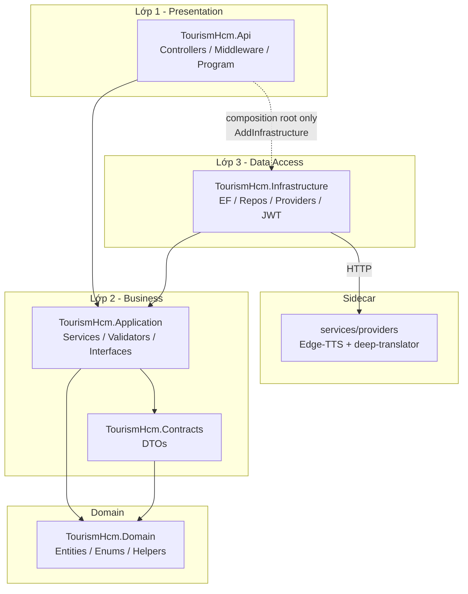
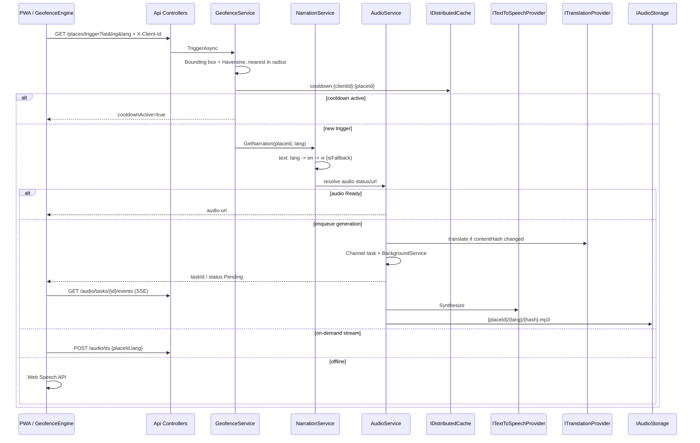
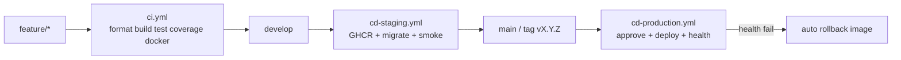

# Architecture — TourismHcm

## 3-layer dependency direction

Platform extras (HTML parity, domain TourismHcm): RBAC permissions, Admin portal, Gemini AI, PMTiles maps (`docs/maps.md`), analytics consent, UI bundles, localization on-demand/warmup.

Rules enforced by `TourismHcm.ArchitectureTests`:

- Controllers never use `DbContext` / repository types.
- Application never references EF Core or ASP.NET Core.
- Domain has no project references to other TourismHcm assemblies.
- Infrastructure implements Application interfaces.

## Geofence → narration → audio fallback

## CI/CD pipeline

### Migration expand/contract

Rollback of a container image does **not** undo SQL. Every migration must remain compatible with the previous app version until a later contract phase removes unused columns.

## Provider policy

| Environment | Missing Google/Azure keys |
|-------------|---------------------------|
| Development | Sidecar **Free** translate + **Edge** TTS (`providers` on :8090) |
| Testing | Fake stubs (no network sidecar) |
| Production | Real providers; `IsConfigured=false` → **503** ProblemDetails, never fake data |
